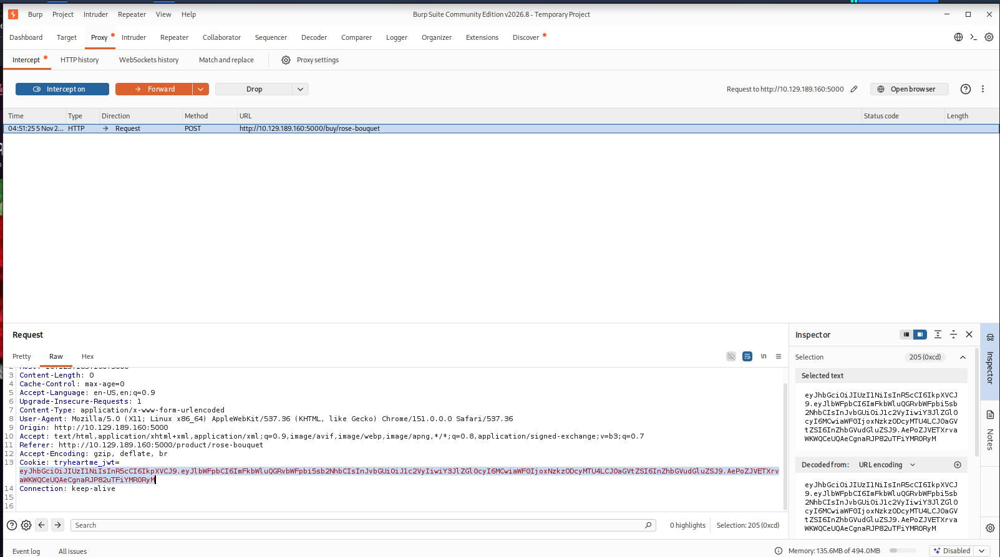
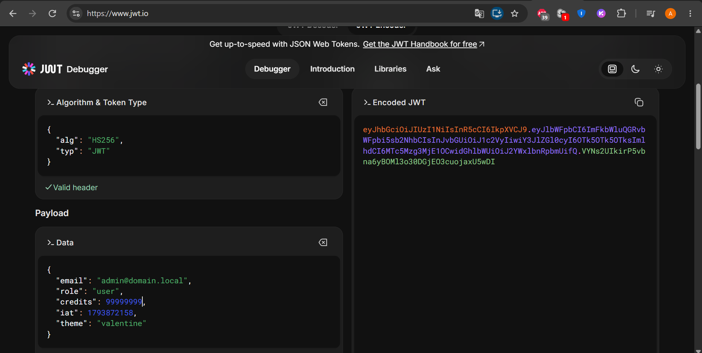
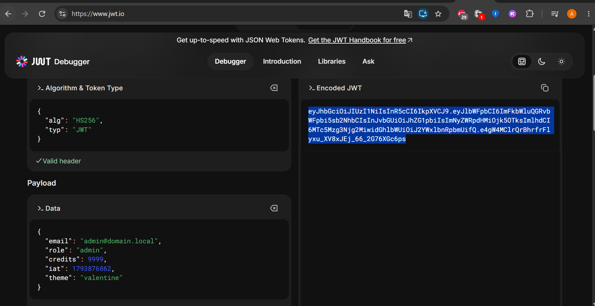
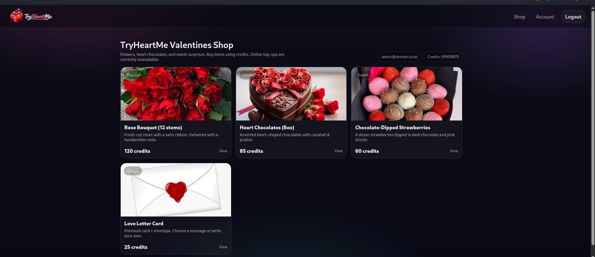

# TryHackMe — TryHeartMe (JWT Tampering)

| | |
|---|---|
| **Room** | [TryHeartMe](https://tryhackme.com/room/tryheartme) |
| **Plateforme** | TryHackMe |
| **Catégorie** | Web Authentification / Autorisation |
| **Vulnérabilité** | JSON Web Token (JWT) falsifiable côté client | élévation de privilèges |
| **Cible** | Boutique en ligne "TryHeartMe" (`http://MACHINE_IP:5000`) |
| **Outils** | Burp Suite (Proxy/Intercept), jwt.io (JWT Debugger), outils de développement du navigateur |
| **Statut** | Terminé | flag "Valenflag" récupéré |

>  **Cadre d'exercice.** Cible fournie par TryHackMe pour l'apprentissage, isolée et détruite en fin de session. Les tokens, montants de crédits et rôles ci-dessous n'ont de valeur que dans ce contexte. Modifier un JWT pour s'octroyer des privilèges sur un système réel sans autorisation écrite est illégal.

## Sommaire

1. [Contexte applicatif](#1-contexte-applicatif)
2. [Reconnaissance — comprendre le flux d'achat](#2-reconnaissance--comprendre-le-flux-dachat)
3. [Interception de la requête et découverte du JWT](#3-interception-de-la-requête-et-découverte-du-jwt)
4. [Analyse du JWT](#4-analyse-du-jwt)
5. [Falsification du token (élévation de privilèges + crédits)](#5-falsification-du-token-élévation-de-privilèges--crédits)
6. [Injection du token falsifié et accès au contenu caché](#6-injection-du-token-falsifié-et-accès-au-contenu-caché)
7. [Capture du flag](#7-capture-du-flag)
8. [Ce qu'il faut retenir](#8-ce-quil-faut-retenir)
9. [Recommandations défensives](#9-recommandations-défensives)
10. [Références](#10-références)

---

## 1. Contexte applicatif

TryHeartMe est une boutique en ligne de la Saint-Valentin : bouquets, chocolats, carte de vœux. Chaque article coûte un certain nombre de **crédits**, affichés sur le compte utilisateur. L'énoncé demande d'acheter un article caché, le **"Valenflag"**, qui n'apparaît pas dans le catalogue normal.

Un compte fraîchement créé démarre avec **0 crédit** — impossible donc d'acheter quoi que ce soit normalement. C'est le point de blocage qui oriente immédiatement l'attaque : il faut soit obtenir des crédits, soit obtenir un rôle qui en donne accès sans paiement.

## 2. Reconnaissance — comprendre le flux d'achat

Après inscription et connexion, la navigation dans la boutique montre un catalogue classique (Rose Bouquet, Heart Chocolates, Chocolate-Dipped Strawberries, Love Letter Card). Aucun article "Valenflag" n'est visible à ce stade — ce qui laisse supposer qu'il est **conditionné à un rôle ou un solde particulier**, probablement masqué côté front-end plutôt que réellement absent du système.

Tentative d'achat d'un article (`Rose Bouquet`) avec Burp Suite en interception active, pour observer la requête brute envoyée au serveur.

## 3. Interception de la requête et découverte du JWT

```
POST /buy/rose-bouquet HTTP/1.1
Host: 10.129.189.160:5000
Cookie: tryheartme_jwt=eyJhbGciOiJIUzI1NiIsInR5cCI6IkpXVCJ9. ...
```



**Observation clé :** l'application n'utilise pas de session côté serveur classique, mais un **cookie JWT** (`tryheartme_jwt`) envoyé à chaque requête. Un JWT se décompose en trois parties séparées par des points : `header.payload.signature`. Les deux premières parties ne sont **pas chiffrées**, seulement encodées en Base64URL — n'importe qui peut les lire et, potentiellement, les modifier.

> **À retenir :** dès qu'une application s'appuie sur un cookie qui "a la forme" de trois blocs séparés par des points commençant par `eyJ`, c'est un JWT. Réflexe à avoir systématiquement : le décoder pour voir ce qu'il contient réellement.

## 4. Analyse du JWT

Le JWT intercepté est copié dans le **JWT Debugger** de [jwt.io](https://jwt.io), qui décode instantanément le header et le payload.



**Payload observé :**
```json
{
  "email": "admin@domain.local",
  "role": "user",
  "credits": 99999999,
  "iat": 1793872158,
  "theme": "valentine"
}
```

**Deux signaux d'alarme immédiats :**
1. Le champ **`credits`** est présent *directement dans le token*, alors qu'un solde de compte est une donnée qui ne devrait **jamais** vivre côté client — elle doit être recalculée et vérifiée en base de données à chaque requête serveur.
2. Le champ **`role`** est également dans le token (`"user"`), ce qui signifie que l'autorisation dépend probablement de ce champ lu directement depuis le cookie, plutôt que d'une vérification en base.

> **À retenir :** un JWT bien conçu ne devrait contenir que des informations d'identification stables et non sensibles (identifiant utilisateur, éventuellement un rôle figé au moment de l'émission pour des cas non critiques) — jamais des données mutables comme un solde ou des droits dynamiques. Le simple fait de voir `credits` ou `role` en clair dans le payload est un indice fort d'une mauvaise architecture d'autorisation.

## 5. Falsification du token (élévation de privilèges + crédits)

Toujours dans le JWT Debugger, le **payload** est édité directement :

```json
{
  "email": "admin@domain.local",
  "role": "admin",
  "credits": 9999,
  "iat": 1793876862,
  "theme": "valentine"
}
```



jwt.io génère alors un **nouveau token encodé et signé** (avec la clé renseignée dans l'outil). Le fait que ce nouveau token ait ensuite été accepté par le serveur démontre que l'application **ne valide pas correctement la signature** du JWT reçu — soit elle ne vérifie pas la signature du tout, soit elle utilise un secret de signature faible/par défaut/devinable, ce qui revient à ne quasiment aucune protection.

> **À retenir :** signer un JWT ne sert à rien si le serveur ne vérifie pas réellement cette signature à la réception, ou s'il utilise une clé secrète triviale. Un token "signé" qui n'est pas vérifié correctement est fonctionnellement équivalent à un token en clair — n'importe qui peut en forger un valide.

## 6. Injection du token falsifié et accès au contenu caché

Le nouveau JWT encodé est copié, puis injecté dans le navigateur via les **outils de développement → Application/Storage → Cookies**, en remplaçant la valeur du cookie `tryheartme_jwt` existant. Après rechargement de la page :



**Résultat immédiat, sans aucune autre action :**
- L'en-tête affiche `admin@domain.local` avec **Credits: 99999879** (le solde a été recalculé par le serveur à partir du token falsifié, preuve supplémentaire que le solde est piloté par le JWT et non par une base de données côté serveur).
- Un nouvel article, jusque-là invisible, apparaît désormais dans le catalogue — l'article caché "Valenflag" révélé par le passage en rôle `admin`.

> **À retenir :** l'affichage conditionnel d'un élément d'interface selon un rôle lu côté client (ici le JWT) n'est **jamais** un contrôle de sécurité — ce n'est qu'une question de confort d'affichage. Le vrai contrôle doit se faire côté serveur, à chaque requête sensible (achat, accès à une ressource), indépendamment de ce que le front-end choisit d'afficher.

## 7. Capture du flag

L'achat de l'article caché déclenche la récupération du flag **"Valenflag"**, validé dans la room comme réponse à la question "What is the flag?".

---

## 8. Ce qu'il faut retenir

| Étape | Compétence démontrée |
|---|---|
| Observation du cookie JWT via Burp | Reconnaissance du mécanisme d'authentification réel de l'application (pas de session serveur classique) |
| Décodage du JWT sur jwt.io | Compréhension de la structure JWT (header/payload/signature) et de ce qu'il ne faut jamais y mettre |
| Modification du payload (`role`, `credits`) | Identification d'une faille de confiance côté client (le serveur fait confiance à des données modifiables par l'utilisateur) |
| Injection du token forgé dans le navigateur | Démonstration concrète d'une élévation de privilèges horizontale → verticale sans exploit "code", juste de la logique applicative |
| Apparition de l'article caché | Compréhension que le contrôle d'accès basé uniquement sur l'affichage front-end n'est pas un contrôle de sécurité |

## 9. Recommandations défensives

Cette vulnérabilité est une variante très répandue des failles **Broken Authentication / Broken Authorization** du top 10 OWASP (Web et API). Voici comment un développeur aurait pu la prévenir :

### Contre la falsification du JWT
- **Toujours vérifier la signature côté serveur** avec une fonction de vérification stricte (`jwt.verify()`), jamais seulement `jwt.decode()` qui lit le contenu sans rien valider.
- **Utiliser un secret de signature fort** : aléatoire, long (≥256 bits pour HS256), jamais une valeur par défaut, un mot trivial ou une chaîne présente dans un dépôt de code public.
- **Préférer un algorithme asymétrique (RS256/ES256)** pour les JWT sensibles : le serveur signe avec une clé privée qu'il est seul à détenir, et même en lisant le token, un attaquant ne peut pas en forger un nouveau sans cette clé.
- **Épingler l'algorithme attendu** côté vérification (`algorithms: ["HS256"]` explicitement) pour empêcher les attaques de type *"alg: none"* ou de confusion d'algorithme (RS256 → HS256).

### Contre le stockage de données sensibles dans le token
- **Ne jamais mettre dans le payload** des données mutables ou sensibles comme un solde de compte, des permissions fines ou des quotas — le JWT ne doit porter qu'un identifiant stable (ex. `user_id`).
- **Relire le rôle et le solde en base de données à chaque requête sensible** (achat, accès à une ressource protégée), jamais depuis le token.
- Pour l'autorisation, appliquer le principe : *"le client propose, le serveur vérifie"* — un rôle ou un droit affiché au client ne doit jamais être la source de vérité.

### Contre la logique d'affichage conditionnel
- Ne jamais considérer qu'un élément "caché" côté front-end (CSS, JS, rendu conditionnel) est protégé — l'API ou la route serveur correspondante doit elle-même refuser l'accès si le rôle n'est pas valide, indépendamment de ce qui est affiché.
- Auditer régulièrement les endpoints pour s'assurer qu'aucune route "admin" n'est accessible sans vérification serveur réelle du rôle.

### Hygiène générale
- Donner des tokens à **durée de vie courte** et prévoir un mécanisme de révocation (liste noire, rotation de secret) en cas de compromission.
- Mettre en place une **détection d'anomalie** côté serveur : un rôle qui change brutalement entre deux requêtes pour le même utilisateur, ou un solde qui augmente sans transaction associée, doit déclencher une alerte.

## 10. Références

- [TryHackMe — Room TryHeartMe](https://tryhackme.com/room/tryheartme)
- [jwt.io — JWT Debugger](https://jwt.io)
- [OWASP — JSON Web Token Cheat Sheet](https://cheatsheetseries.owasp.org/cheatsheets/JSON_Web_Token_for_Java_Cheat_Sheet.html)
- [OWASP API Security Top 10 (2023) — API2 Broken Authentication / API5 Broken Function Level Authorization](https://owasp.org/API-Security/editions/2023/en/0x11-t10/)
- [PortSwigger — JWT attacks](https://portswigger.net/web-security/jwt)
